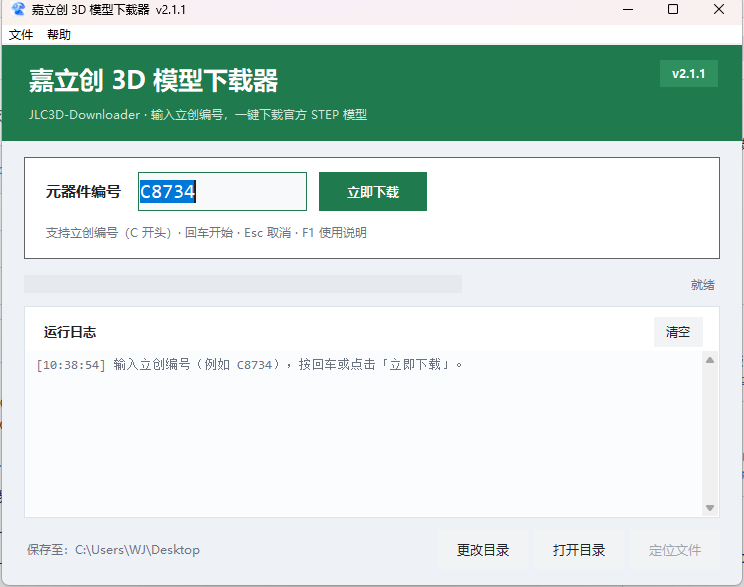

# 嘉立创 3D 模型下载器 (JLC3D-Downloader)

输入立创 / 嘉立创编号（例如 `C8734`），一键从 **JLCEDA / EasyEDA 官方库** 下载对应的 STEP 格式 3D 模型。



当前版本 **2.1.1**：重写了网络层与下载流程，直接读取官方元件接口里的 3D 模型关联，请求更少、更稳定；界面改为大标题栏 + 卡片式布局，并新增「帮助 → 使用说明」。

## 下载

- **普通用户**：从 [Releases](https://github.com/Jupiter1028/JLC3D_Downloader/releases/latest) 下载 `JLC3D-Downloader-*-win64.exe`，双击即可运行，无需安装 Python。
- **开发者**：克隆仓库后按下方「安装与运行」从源码启动。

> 仓库只保留源码与图标资源，可执行文件统一放在 Releases 附件中，避免仓库体积随版本膨胀。

## 功能

- 输入立创编号一键下载 `.step` 文件，回车即可开始
- 官方元件接口直连，单个器件通常只需 2 次网络请求
- 自动处理 3D 库记录（`uuid_3d`）与文件 uuid 不一致的情况
- 模型文件双镜像回退（`modules.lceda.cn` → `modules.easyeda.com`）
- 下载进度、速度显示，可随时取消
- 断点安全：先写临时文件再原子替换，失败不会留下半个 `.step`
- 自动校验 STEP 文件头，风控页面不会被当成模型保存
- 记住下载目录，支持“打开目录 / 定位文件”
- 出错时给出可读原因，并把详细诊断写入日志文件
- 应用内「使用说明」（F1）、自定义图标、悬停反馈与快捷键

## 环境要求

- Windows 10 / 11（x64），理论上也支持 macOS / Linux（未做打包验证）
- Python 3.9 及以上（开发/打包环境为 3.11）
- 依赖：`requests`（见 `requirements.txt`）

## 安装与运行

```powershell
pip install -r requirements.txt
python JLC3DDownload.py
```

或从 [Releases](https://github.com/Jupiter1028/JLC3D_Downloader/releases/latest) 下载打包好的 exe（无需安装 Python）。

## 使用

1. 在输入框填入编号，例如 `C8734`；
2. 点击“立即下载”或直接按回车；
3. 下载完成后点击“定位文件”，即可在资源管理器中选中该 `.step`。

下载目录默认为系统桌面，可在“文件 → 更改下载目录…”中修改，设置会保存在本地。

快捷键：`Enter` 开始下载，`Esc` 取消，`F1` 打开使用说明。菜单「帮助 → 使用说明」里有完整的功能说明与常见问题。

## 配置与日志

程序自身的数据统一放在：

```
%LOCALAPPDATA%\JLC3D-Downloader\
├── config.ini    # 下载目录
└── app.log       # 运行日志（超过 1 MB 自动轮转）
```

旧版本使用的 `~/.jlc3d/config.ini` 会在首次启动时自动迁移，原文件保留不动。

## 工作原理

```
GET https://lceda.cn/api/products/<C编号>/components
      └─ packageDetail.dataStr
           ├─ SVGNODE(c_etype=outline3D).attrs.uuid   → 模型文件 uuid
           └─ head.uuid_3d                            → 3D 库记录（docType=16）
                └─ GET https://lceda.cn/api/components/<uuid> → 真正的文件 uuid
GET https://modules.lceda.cn/qAxj6KHrDKw4blvCG8QJPs7Y/<uuid>
      └─ 校验 ISO-10303-21 → 原子写入 <编号>.step
```

兜底链路：当 EasyEDA 元件接口没有该器件时，回退到 `pro.lceda.cn` 的搜索接口（搜索 → 器件属性 `3D Model` → 模型文件 uuid）。

> **关于 User-Agent**
> 嘉立创前置的 CloudWAF 会拦截“裸爬虫”标识。实测只发送 `User-Agent: Mozilla/5.0`
> 会被判定为攻击行为并返回 **HTTP 418**。本程序使用带版本号的自定义 UA；如果仍然
> 被拦截，会自动切换浏览器 UA 重试一次。

## 打包 EXE

```powershell
pip install pyinstaller
pyinstaller --noconfirm --clean --onefile --windowed --name "嘉立创3D下载器" `
    --icon assets\app.ico --add-data "assets;assets" JLC3DDownload.py
```

产物在 `dist\嘉立创3D下载器.exe`。

### 发布新版本

1. 更新 `VERSION`、README 的版本记录并提交；
2. 打标签并推送：`git tag v2.1.2 && git push origin v2.1.2`；
3. GitHub Actions 会自动在 Windows 上构建 exe，并作为附件上传到对应 Release（见 `.github/workflows/release.yml`）。

## 自检与测试

```powershell
# 单器件端到端自检（无界面，检查解析 + 下载 + 落盘）
python JLC3DDownload.py --selftest C8734

# 离线单元测试
python -m unittest discover -s tests -v
```

## 常见问题

| 现象 | 原因与处理 |
| --- | --- |
| 提示 HTTP 418 / 被风控拦截 | 触发频率限制。程序会自动换 UA 重试一次；仍失败请稍后再试 |
| 提示“官方库中没有该编号” | 编号不存在，或该器件在官方库里没有 3D 模型 |
| 提示“没有可用的 3D 模型” | 器件存在，但封装上没有关联 3D 文件 |
| 写入失败 / 文件被占用 | 目标文件被其他程序打开，关闭后重试 |
| 无法连接服务器 | 检查网络或系统代理；程序会使用 `HTTP(S)_PROXY` 环境变量 |

遇到无法自行解决的问题时，请附上 `%LOCALAPPDATA%\JLC3D-Downloader\app.log` 反馈。

## 数据来源与声明

- 模型文件与元件数据来自 **JLCEDA / EasyEDA 官方库**，版权归嘉立创 EDA 所有。
- 本工具只做本地便捷转存，不修改、不重新分发官方库内容；请遵守官方库的使用条款。
- 接口为公开接口，若官方调整，程序可能失效，请关注项目更新。

## 版本记录

### 2.1.1

- 应用图标更换为 JLC 3D 图标（窗口、任务栏、EXE 统一）
- 修复 Windows 上同时设置 `iconbitmap` / `iconphoto` 导致显示系统默认图标的问题
- 内嵌 48×48 图标兜底，缺少 `assets` 目录时也能正常显示
- 仓库地址更新为 `Jupiter1028/JLC3D_Downloader`

### 2.1.0

- 全新界面：顶部大标题栏、卡片式输入区、独立日志卡片、按钮悬停反馈
- 新增「帮助 → 使用说明」（快捷键 `F1`），包含快速开始、界面说明、常见问题、快捷键
- 新增应用图标，窗口、任务栏与 EXE 统一使用
- 窗口尺寸按 1366×768 等小屏重新调整，避免超出屏幕
- 「关于」窗口与帮助窗口统一视觉风格，链接可点击

### 2.0.0

- 改用官方元件接口 `/api/products/<编号>/components` 直接解析 3D 模型，减少请求次数
- 修复裸 UA 被 CloudWAF 拦截导致下载全失败的问题，并增加浏览器 UA 兜底
- 修复异常提示丢失（`except` 变量被延迟引用）的问题
- 新增进度/速度显示、取消下载、原子写入、STEP 头校验
- 新增日志文件、配置迁移、已知文件夹（OneDrive 桌面）支持
- 新增 `--selftest` 自检与 `tests/` 离线单元测试，补充 `requirements.txt`

### 1.2

- Tkinter 界面重构，支持下载目录记忆与文件定位

## 致谢

- 思路参考 [kulya97](https://github.com/kulya97) 的原始实现
- 接口链路与健壮性设计参考 [LCSC3D](https://github.com/Travelerrrrrr/LCSC3D) 项目
